# Circular motion diagrams

Figures for the selected scenarios. Backup scenarios are not drawn: the rubber stopper, the wooden ball, the roller-coaster car, and the lab cart.

The orange dot is the object. Vertical figures are side views. Horizontal figures are top views, with north at the top of the page.

Positions are numbered 1, 2, and 3. On a side view, 1 is the top, 2 is the right-hand side, and 3 is the bottom. On a top view, 1 is the left, 2 is north, and 3 is the right.

- String: the dashed circle is the path, and the solid lines are the rope or tether at the three positions.
- Track or road: the solid line or lines are the track, and the dashed lines are radii to the three positions. On a vertical loop, the object is drawn inside the track.
- One arrow shows gravity. Wind or current is a vertical column of arrows on the side the force comes from. Left-to-right arrows are on the left. Right-to-left arrows are on the right.

## 1. Vertical circle on a string

### Bucket of water

A gardener swings a small bucket of water, tied to a rope, through a full vertical circle, and the rope stays taut.

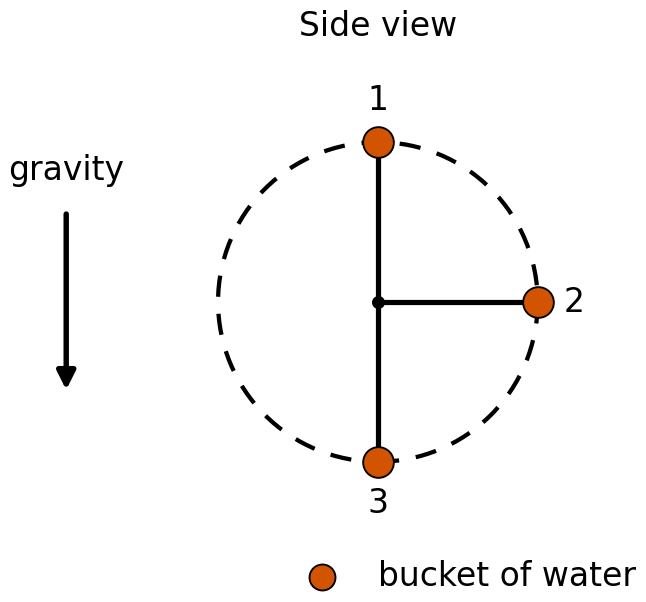

### Steel nut

A student swings a steel nut tied to fishing line through a full vertical circle, and the line stays taut.

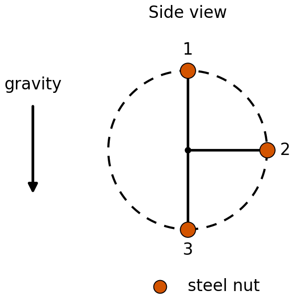

## 2. Vertical circle on a frictionless track

### Toy car

A toy car moves on the inside of a smooth, frictionless vertical loop and does not leave the track.

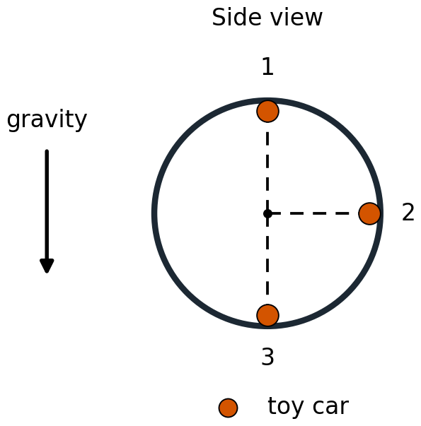

### Glass marble

A glass marble moves on the inside of a smooth, frictionless vertical loop and does not leave the track.

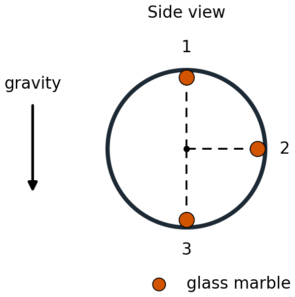

## 3. Horizontal circle on a string

Left-to-right means the wind or current pushes the object toward the right side of the figure.

### Model airplane

A model airplane flies in a horizontal circle at the end of a horizontal tether in a steady horizontal wind. The wind pushes left to right.

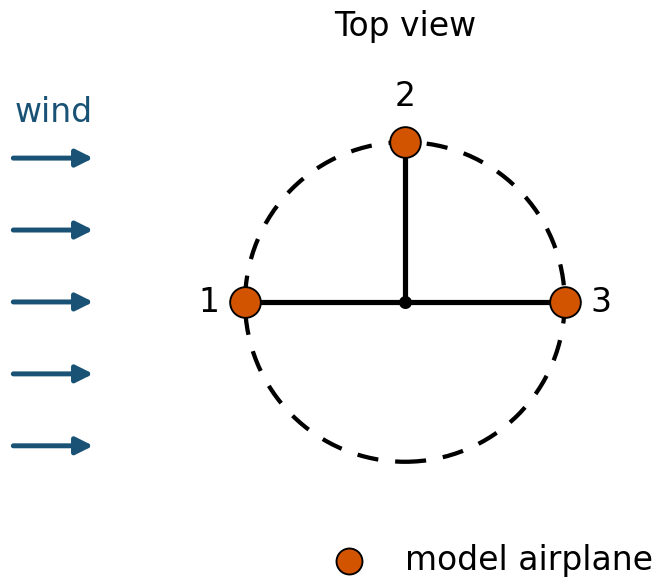

### Model boat

A model boat moves in a horizontal circle, tied by a horizontal line to a fixed post, in a steady current. The current pushes left to right.

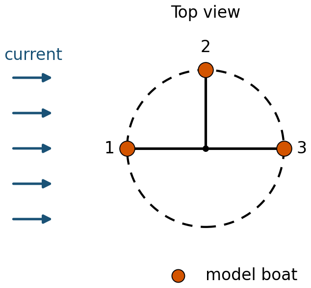

### Model car

A model car on a smooth, frictionless table moves in a horizontal circle, tied by a horizontal cord to a fixed peg, in a steady horizontal wind. The wind pushes right to left.

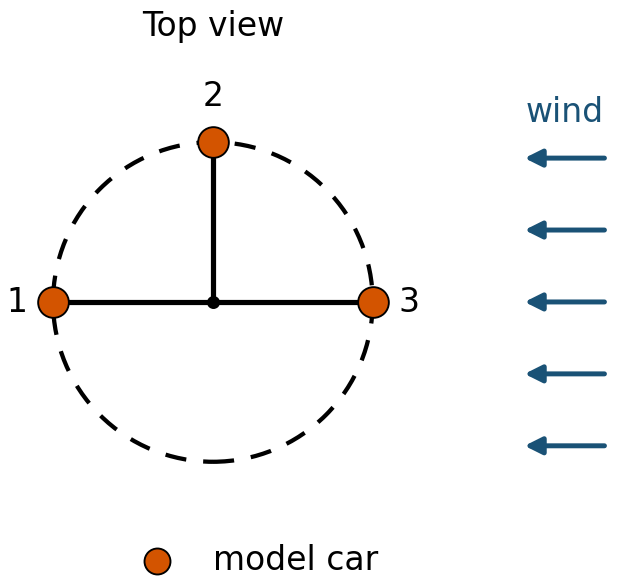

### Underwater probe

A small underwater probe moves in a horizontal circle at the end of a horizontal tether in a steady current. The current pushes right to left.

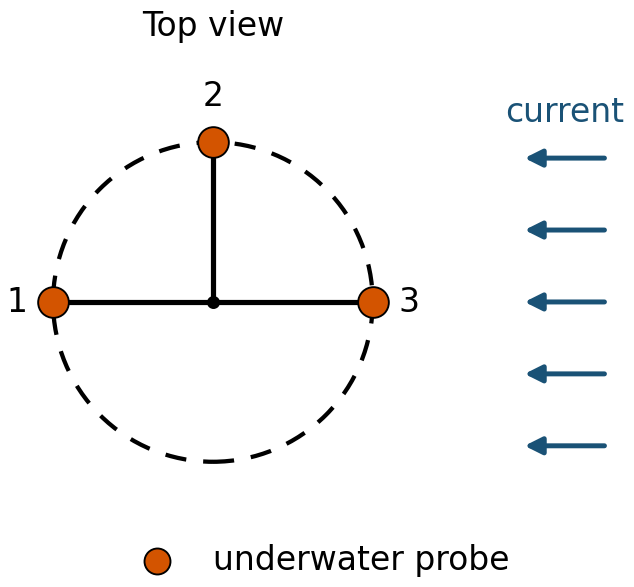

## 4. Horizontal circle on a flat road

The road is flat and unbanked. Static friction is the inward force. The road's normal force is vertical and is not in the radial equation.

### Car

A car drives at constant speed around a flat, unbanked circular track in a steady horizontal wind. The wind pushes left to right.

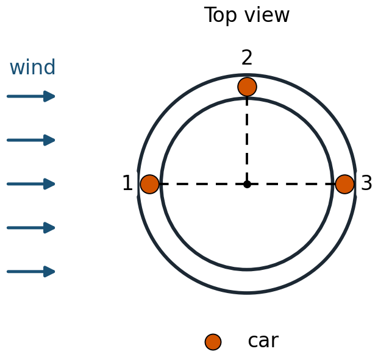

### Delivery truck

A delivery truck drives at constant speed around a flat, unbanked circular lot in a steady horizontal wind. The wind pushes left to right.

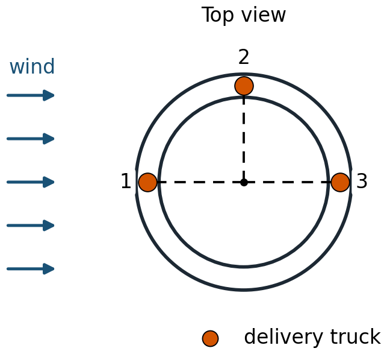

### Bicycle and rider

A bicycle and rider move at constant speed around a flat, unbanked circular path in a steady horizontal wind. The wind pushes right to left.

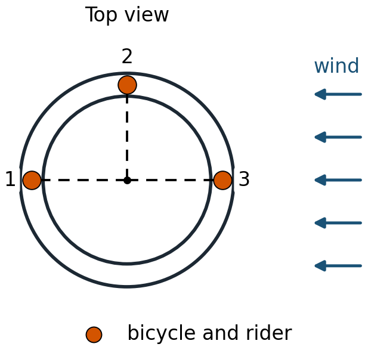

### Motorcycle and rider

A motorcycle and rider move at constant speed around a flat, unbanked circular path in a steady horizontal wind. The wind pushes right to left.

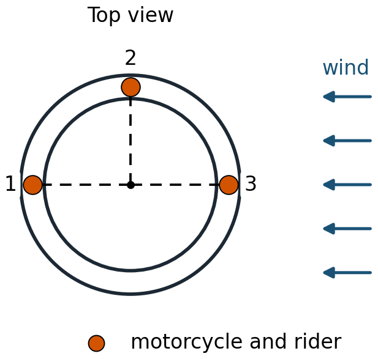
