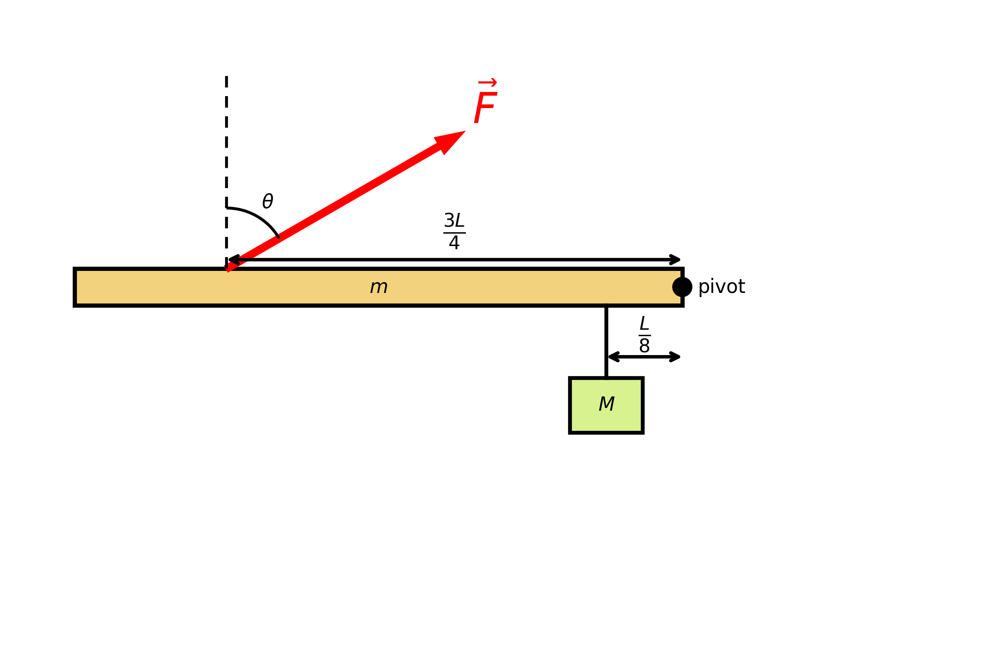

# Multiple-choice draft — first problem

Source bank: `PHY1-RM-TBOR-11112025` (Torque Balance On a Rod)
Source question: `q1`, Static Equilibrium of a Horizontal Rod – Force Determination
Copied bank file: `PHY1-RM-TBOR-11112025.yaml`

## Problem body

A uniform thin rod of length **L = 1.0 m** is held in a **horizontal** position and can rotate freely about a **pivot located at the right end** of the rod. The rod is in **static equilibrium**. The rod’s weight is **32 N**. A block of weight **4 N** is suspended from the rod **at $\tfrac{1}{8}L$ from the right end**.

An external force **F** is applied on the rod **at $\tfrac{3}{4}L$ from the right end**. The force points **upward at an angle of $60^\circ$** with respect to the vertical, as shown in the image. All distances are measured from the **right end** of the rod.

Determine the **magnitude of the force $F$** (in newtons) required to maintain equilibrium. **Round your answer to the nearest integer.**

The original bank names this figure `q1_p0_b_18_f34.png` but does not store the image file. The copy here was regenerated with that bank’s `draw_beam_diagram` function: pivot at the right end, block at $L/8$, force at $3L/4$, and $\theta = 60^\circ$ from the vertical.

The rod weight is **32 N** and the block weight is **4 N**. With the old pair, 8 N and 4 N, the sum of the weights was 12 N, the same as the correct force. These weights keep every choice below on a different integer. The figure is unchanged: it does not label the weights, and the pivot, block, and force stay at the right end, $L/8$, and $3L/4$.

## Correct answer

**44 N**

About the right-end pivot, with counterclockwise positive:

$\tau_b = 4\left(\tfrac{1}{8}\right) = \tfrac{1}{2}, \quad \tau_r = 32\left(\tfrac{1}{2}\right) = 16, \quad \tau_F = -\left(\tfrac{1}{2}F\right)\left(\tfrac{3}{4}\right) = -\tfrac{3}{8}F.$

The component perpendicular to the rod is $F\cos 60^\circ = F/2$. Equilibrium gives $\tfrac{1}{2} + 16 - \tfrac{3}{8}F = 0$, so $F = 44 \text{ N}$.

## Suggested choices

| Choice | Role | Misconception |
| --- | --- | --- |
| 44 N | Correct | Both weights produce torque in the same direction about the right-end pivot. The rod’s weight acts at its center, $L/2$. The upward force contributes $F\cos 60^\circ$ at lever arm $3L/4$. |
| 22 N | Distractor | The 60° angle is ignored and the full force is treated as perpendicular to the rod: $16.5 = F \cdot (3/4)$. |
| 25 N | Distractor | Sine and cosine are swapped. $F\sin 60^\circ$ is used as the perpendicular component, which gives $44/\sqrt{3} \approx 25.40 \text{ N}$, rounded to 25 N. |
| 41 N | Distractor | The block and the rod are given opposite torque directions. $\lvert 16 - 0.5 \rvert = (3/8)F$ gives $41.33 \text{ N}$, rounded to 41 N. Both weights are on the same side of this pivot, so their torques have the same sign. |
| 1 N | Distractor | The mass of the beam is ignored. Only the block is balanced: $0.5 = (3/8)F$ gives $1.33 \text{ N}$, rounded to 1 N. |
| 87 N | Distractor | The beam’s torque is calculated with the full length $L$, not the center of mass at $L/2$. Then $0.5 + 32 = (3/8)F$ gives $86.67 \text{ N}$, rounded to 87 N. |
| 36 N | Distractor | The two weights are added and the result is reported as the force: $4 + 32 = 36 \text{ N}$. Lever arms and the angle never enter. |

